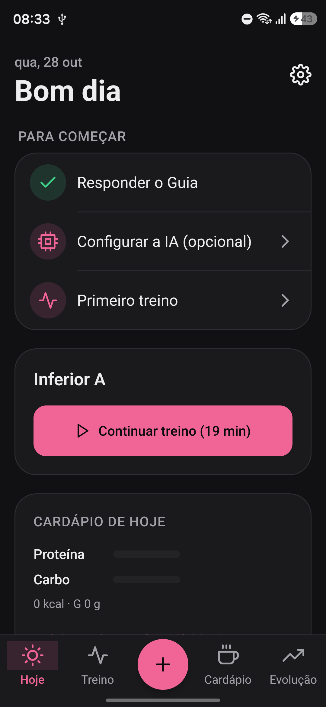
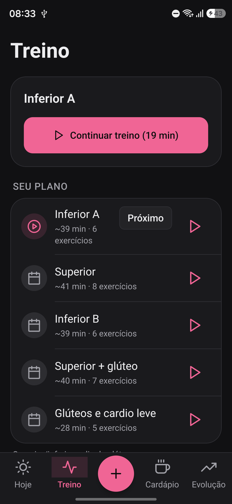
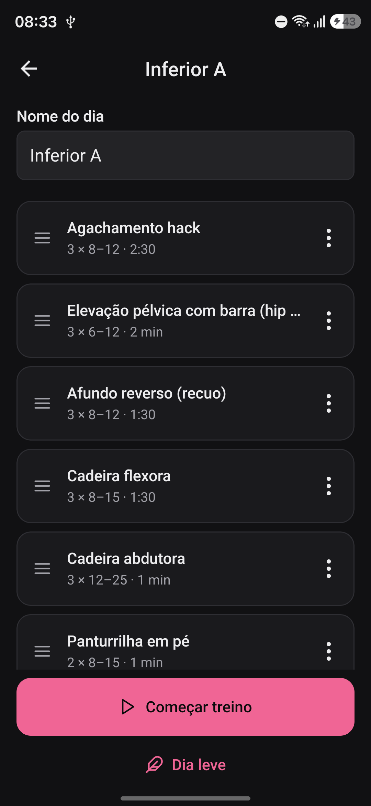
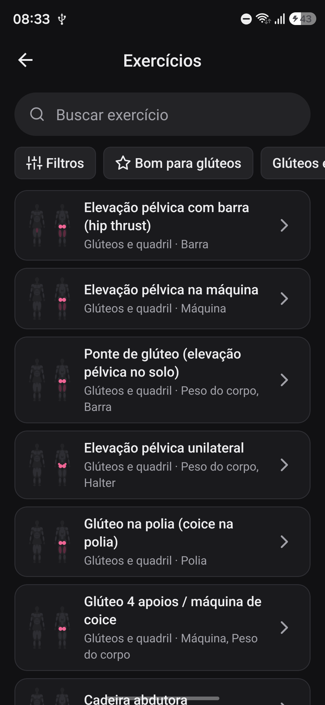
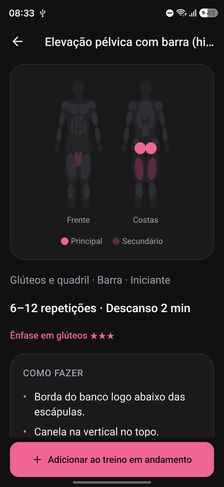
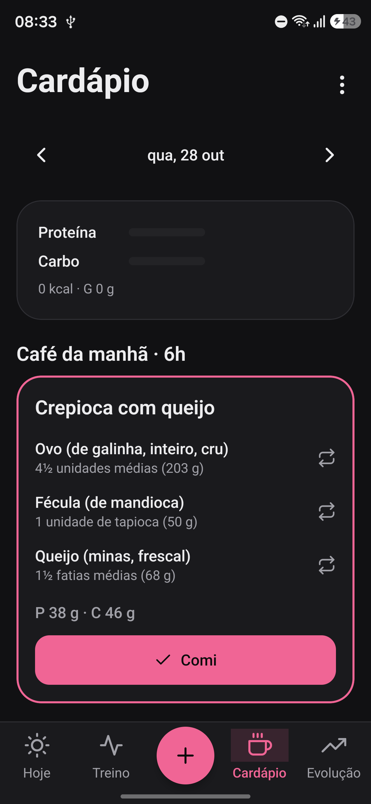

# MGym

App Android pessoal para treinar na academia, seguir um cardápio e acompanhar a evolução do corpo. Um **Guia** de poucas perguntas monta o treino e o cardápio a partir dos seus objetivos, e a tela **Hoje** mostra o que fazer, sem precisar pensar.

<p align="center">
  <a href="https://github.com/AmyNunes/MGym/releases/latest/download/MGym.apk"><b>Baixar o APK (Android)</b></a>
  ·
  <a href="https://github.com/AmyNunes/MGym/releases/latest">Todas as versões</a>
</p>

## Por que eu criei

- **Ter uma noção dos meus treinos** e do tipo de treino que faz sentido para o meu corpo.
- **Saber quais exercícios são ideais para os meus objetivos**, com explicação de como fazer e onde sentir.
- **Me motivar a ir** sem ficar pensando "qual é o treino de hoje?": abro o app e o treino do dia já está lá.

## Como ele é

<table>
  <tr>
    <td align="center"><br><sub>Hoje: o treino do dia</sub></td>
    <td align="center"><br><sub>Treino: o plano da semana</sub></td>
    <td align="center"><br><sub>Um dia do plano</sub></td>
  </tr>
  <tr>
    <td align="center"><br><sub>Catálogo de exercícios</sub></td>
    <td align="center"><br><sub>Exercício com o mapa muscular</sub></td>
    <td align="center"><br><sub>Cardápio do dia</sub></td>
  </tr>
</table>

## O que ele faz

- **Guia:** perguntas sobre objetivo (silhueta mais feminina, força e saúde, perder gordura com calma ou ganhar massa), prioridades, experiência, dias por semana, tempo de treino, limitações e alimentação. No fim, monta o plano e as metas de comida.
- **Plano de treino:** de 2 a 5 dias por semana, com o volume de cada músculo calculado e glúteos em destaque quando é o objetivo. Quem está começando faz as 2 primeiras semanas mais leves para aprender os movimentos.
- **Hoje:** o treino do dia (ou descanso), a próxima refeição e o check-in da semana.
- **Treino em andamento:** séries já preenchidas com a última vez, teclado numérico grande, descanso com aviso no celular, recordes pessoais, sugestão de carga para a próxima vez e calculadora de anilhas.
- **Catálogo:** 66 exercícios em português, com mapa muscular, passo a passo, erros comuns, cuidados e trocas equivalentes.
- **Cardápio:** 3 opções por refeição com alimentos da Tabela TACO, em medidas caseiras ("1 colher de sopa", "2 fatias"), trocas que mantêm a proteína e lista de compras.
- **Evolução:** peso com linha de tendência (sem o sobe-e-desce do dia a dia), medidas com guia de como medir, força, constância e um check-in semanal que sugere ajustes.
- **IA opcional:** com a sua própria chave de uma API compatível com OpenAI, explica exercícios, sugere refeições e ajusta o plano. A IA só escolhe alimentos e exercícios do próprio app: os números de nutrição sempre vêm da TACO.
- **Lembretes:** dia de treino, pesagem, medidas e check-in, com horário de silêncio e texto discreto na tela bloqueada.
- **Backup:** exporta e importa tudo num arquivo (para o Google Drive, por exemplo).

## Privacidade

Tudo fica **no celular**: sem conta, sem servidor e sem coleta de dados. A chave da IA é guardada no armazenamento seguro do Android e nunca vai para o backup. Dá para esconder o peso das telas.

## Saúde

O MGym ajuda a organizar e a praticar com segurança, mas **não substitui médico, nutricionista ou profissional de educação física**. Ele não prescreve dietas agressivas e não orienta sobre hormônios ou doses. A tela **Ajuda e segurança** lista os sinais para procurar atendimento.

## Como instalar

Só para **Android** (não há versão para iPhone).

1. No celular, baixe o [MGym.apk](https://github.com/AmyNunes/MGym/releases/latest/download/MGym.apk).
2. Abra o arquivo. Se o Android pedir, permita **instalar apps desta fonte**.
3. Abra o **MGym** e toque em **Responder o Guia**.

O APK é de um projeto pessoal e vem assinado com a chave de desenvolvimento do Android, não com uma chave de loja.

## Como usar

1. **Responda o Guia** (uns 5 minutos). No fim, você vê o plano, o volume por músculo e as metas de comida.
2. No dia de treino, abra o app: **Hoje** mostra o treino. Toque em **Começar treino**.
3. Em cada série, ajuste a carga e as repetições e toque no **✓**. O descanso começa sozinho.
4. Ao terminar, veja o resumo. Na próxima vez, o app sugere a carga.
5. Marque as refeições em **Cardápio** e registre o peso pelo botão **+**.
6. No fim de semana, faça o **check-in** em **Evolução**.

## Para quem programa

Feito com Expo SDK 58, React Native 0.88 e TypeScript. Usa Expo Router, SQLite (`expo-sqlite`), Zustand, Zod, Reanimated e `react-native-svg` (gráficos e mapa muscular desenhados no próprio app).

```
src/training/    plano, progressão, recordes e volume (funções puras e testadas)
src/nutrition/   metas, macros, cardápio e trocas
src/body/        tendência do peso e medidas
src/data/        catálogo de exercícios, alimentos (TACO) e refeições-modelo
src/db/          banco, migrations e repositórios
app/             telas (Expo Router)
modules/         módulo nativo (contagem do descanso na notificação)
```

Precisa de Node 24 e do Android SDK. Com o celular no cabo e a depuração USB ligada:

```
npm install
npx expo run:android      # compila e instala a versão de desenvolvimento
npm test                  # testes
npx tsc --noEmit          # tipos
npx expo lint             # lint
```

APK que funciona sem o computador (a pasta `android/` é gerada pelo `npx expo run:android` ou pelo `npx expo prebuild`):

```
cd android
./gradlew assembleRelease -PreactNativeArchitectures=arm64-v8a
```

O arquivo sai em `android/app/build/outputs/apk/release/app-release.apk`.

As escolhas do plano (volume por músculo, progressão, segurança) estão explicadas, com as fontes, em [docs/PESQUISA.md](docs/PESQUISA.md). O catálogo de exercícios está em [docs/EXERCICIOS.md](docs/EXERCICIOS.md).

## Créditos

- **Tabela TACO**: Tabela Brasileira de Composição de Alimentos, 4ª edição, NEPA/UNICAMP, 2011.
- **Medidas caseiras**: IBGE, Pesquisa de Orçamentos Familiares 2008–2009.

## Licença

[MIT](LICENSE)
